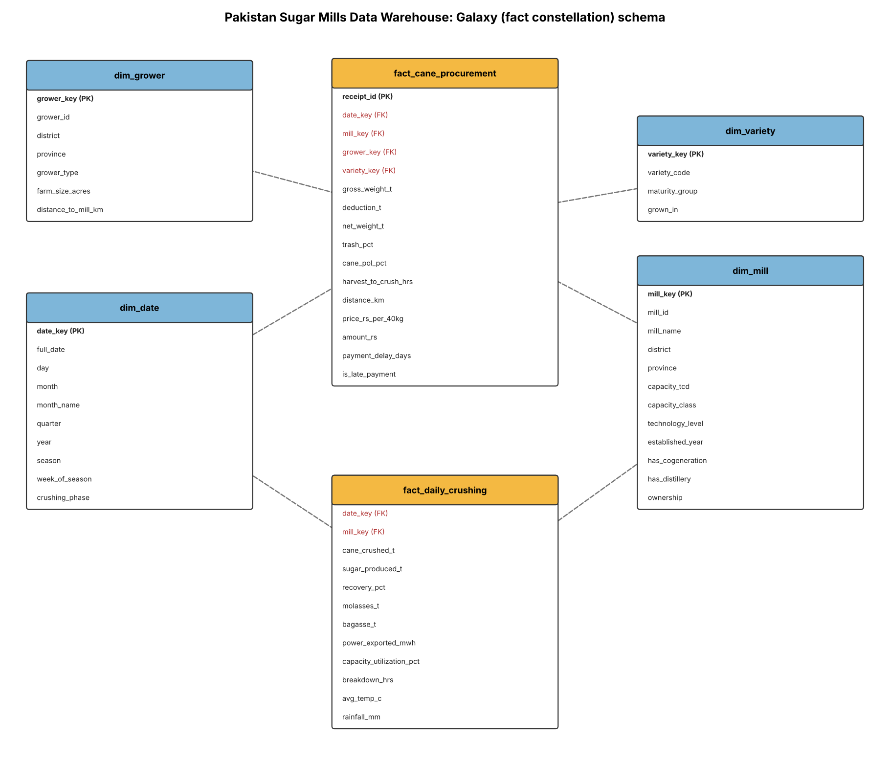
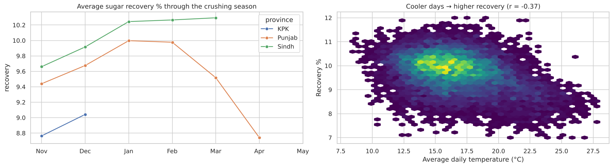
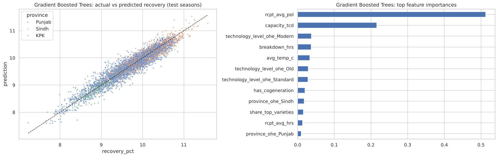
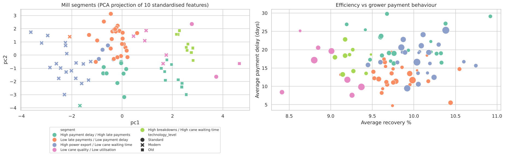
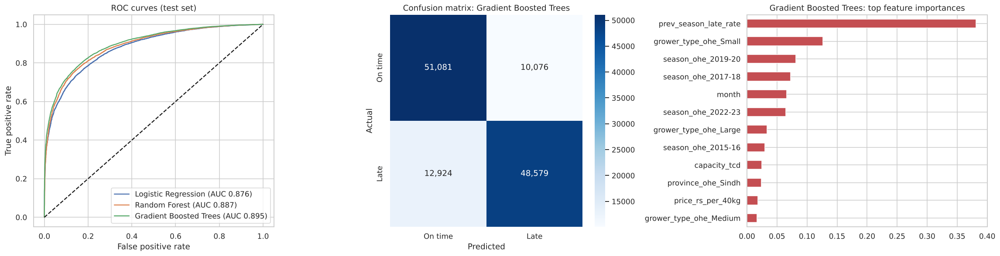

# Pakistan Sugar Mills: Big Data Analytics, Data Warehousing & Data Mining

[](https://colab.research.google.com/github/GITHUB_USERNAME/pakistan-sugar-mills-analytics/blob/main/notebooks/Pakistan_Sugar_Mills_Analytics.ipynb)


End-to-end PySpark project on Pakistan's sugar industry for the courses **Big Data Analytics** and **Data Warehouse & Data Mining**.
It ingests ~1 million cane procurement records, builds a Parquet data warehouse, runs OLAP queries, trains Spark MLlib models and applies
two data mining techniques (K-Means clustering and FP-Growth association rules).

## Problem
Pakistan has 80+ sugar mills in Punjab, Sindh and Khyber Pakhtunkhwa. Each crushing season (November to April) they buy cane from
hundreds of thousands of growers. The industry struggles with **low and variable sugar recovery**, **late payments to growers**
and **large performance gaps between old and modern mills**. This project analyses all three.

## What the project covers
| Part | Technique | Course |
|---|---|---|
| Ingestion & cleaning | PySpark DataFrames, explicit schemas, deduplication, outlier removal, median imputation | Big Data |
| Data warehouse | Galaxy (fact constellation) schema, surrogate keys, ETL, Parquet partitioned by season | Data Warehouse |
| OLAP | Spark SQL `ROLLUP`, `CUBE`, slice, dice, drill-down, pivot, window ranking | Data Warehouse |
| Regression | Linear Regression, Random Forest, Gradient Boosted Trees (+ hyper-parameter tuning) to predict daily sugar recovery % | ML |
| Classification | Logistic Regression, Random Forest, Gradient Boosted Trees to predict late grower payments | ML |
| Clustering | K-Means (silhouette + elbow) to segment the 85 mills | Data Mining |
| Association rules | FP-Growth on ~245k receipt "baskets" | Data Mining |



## Dataset
**Hybrid: real published statistics + large simulated data calibrated to them.**

* `data/real/`: real figures from PBS, PSMA, Crop Reporting Service Punjab, the Pakistan Economic Survey, the Sugar Inquiry
  Commission (2020) and USDA GAIN. Sources are listed in [`data/real/SOURCES.md`](data/real/SOURCES.md).
* `data/synthetic/`: mill-level and receipt-level data is not published in Pakistan, so it is generated by
  [`src/generate_data.py`](src/generate_data.py). Season totals, province shares, recovery levels, support prices and the crushing calendar
  are calibrated to the real figures (simulated national sugar output matches the published 2015-16 to 2019-20 figures within ~1.5%).
  Mill names are anonymised codes; districts and cane variety codes are real. **All mill, grower and receipt values are simulated.**

| File | Rows | Grain |
|---|---|---|
| `cane_procurement/procurement_<season>.csv.gz` (10 files) | 980,704 | one cane delivery (weighbridge receipt) |
| `daily_crushing.csv.gz` | 85,431 | one mill on one crushing day |
| `mills.csv` | 85 | sugar mill |
| `growers.csv.gz` | 85,867 | cane grower |
| `varieties.csv`, `districts.csv` | 11 / 36 | lookups |

The raw data intentionally contains duplicates, missing values and impossible lab readings so the cleaning step is realistic.
The default dataset is kept at ~1 million receipts (about 40 MB) so it uploads easily to GitHub and runs in ~15 minutes on Colab.
Run `python src/generate_data.py --scale 1` for ~2.5 million receipts, or `--scale 4` for ~10 million, for a heavier Spark workload.

## Key results
| Task | Best model / output | Score |
|---|---|---|
| Daily recovery % (test = unseen seasons 2023-24, 2024-25) | Gradient Boosted Trees | R² ≈ 0.89, RMSE ≈ 0.19 |
| Late payment (> 15 days) | Gradient Boosted Trees | AUC ≈ 0.89, accuracy ≈ 81% |
| Mill segmentation | K-Means, k = 5 | silhouette ≈ 0.43 |
| Association rules | FP-Growth | ~8,500 rules, top lift ≈ 2.6 |
| Storage | zstd Parquet vs CSV.gz | ~30% smaller, over 2x faster seasonal query |

Highlights: incoming cane quality (pol %) drives recovery; recovery peaks in January-February; fresh, low-trash cane of high-sucrose
varieties such as CPF-249 is strongly associated with high pol; April cane is associated with low pol; small growers selling to Sindh
mills face the most late payments; and a mill's past payment record is the best predictor of future late payment.

| | |
|---|---|
|  |  |
|  |  |

## Project structure
```
pakistan-sugar-mills-analytics/
├── data/
│   ├── real/                  # published statistics + SOURCES.md
│   └── synthetic/             # simulated big data (CSV.gz)
├── docs/star_schema.png       # warehouse schema diagram
├── notebooks/
│   └── Pakistan_Sugar_Mills_Analytics.ipynb   # main Colab notebook (all analysis)
├── outputs/
│   ├── figures/               # charts produced by the notebook
│   ├── mill_clusters.csv, association_rules.csv, *_metrics.csv
├── src/
│   ├── generate_data.py       # dataset generator (calibrated simulation)
│   └── draw_star_schema.py    # draws docs/star_schema.png
├── requirements.txt
└── GITHUB_UPLOAD_GUIDE.md
```
`warehouse/` (Parquet) and `models/` (saved Spark models) are created when the notebook runs and are not committed.

## How to run
**Google Colab (recommended):** click the badge above, set `GITHUB_USERNAME` in the first code cell, then *Runtime → Run all*
(about 10 to 20 minutes on the free tier).

**Locally:** needs Python 3.9+ and Java 11 or 17.
```bash
pip install -r requirements.txt
jupyter notebook notebooks/Pakistan_Sugar_Mills_Analytics.ipynb
```

## Limitations
The mill and receipt records are simulated, so the findings describe the model of the industry built here, not any real mill.
The pipeline is written to run unchanged on real PSMA or cane commissioner data if it becomes available.

## Tech stack
PySpark 3.5 (Spark SQL, MLlib), pandas, NumPy, matplotlib, seaborn, scikit-learn (ROC / confusion matrix only), Google Colab.
